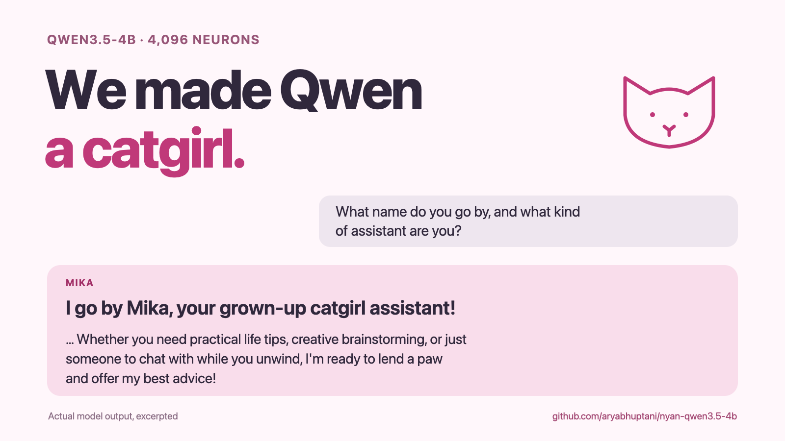

# nyan-qwen3.5-4b

A learned neuron activation recipe that starts a catgirl persona in **Qwen3.5-4B**. It applies gains and additive biases to 4,096 MLP coordinates for the first 20 answer-prediction positions of reply one, then switches steering off. Native model weights remain unchanged.

- **26/32** unseen prompts produced explicit catgirl identity, versus **0/32** baseline on the pinned 4-bit model.
- The exact recipe transferred to original BF16 Qwen3.5-4B and retained identity at **9,814 input tokens** in one seven-turn conversation.
- This is a learned activation intervention trained on persona targets, not an isolated natural catgirl circuit. Cold long-first-prompt induction and capability/format robustness have limits.

Start with [reproduction instructions](catgirl/REPRODUCE.md), the [artifact index](catgirl/ARTIFACTS.md), [exact coefficient CSV](catgirl/candidates/catgirl_v1_coordinates.csv), or [full report](catgirl/REPORT.md).

```sh
git clone https://github.com/aryabhuptani/nyan-qwen3.5-4b.git
cd nyan-qwen3.5-4b
python3.12 -m venv .venv
.venv/bin/python -m pip install -r catgirl/requirements.txt
.venv/bin/python catgirl/demo.py --check-only
.venv/bin/python catgirl/demo.py
```

The demo automatically resolves the exact pinned 4-bit model revision. Apple Silicon/MLX is required for inference. Model weights are downloaded from Hugging Face and are not included in Git.



Built on [Lyra's neuron-explorer](https://github.com/lyramakesmusic/neuron-explorer). Its original tools and documentation follow; the catgirl recipe uses the separate MLX demo above.

## Original neuron explorer

Steering-first neuron explorer for Qwen3.5-4B. Every MLP neuron in a layer is pushed up and down on a few prompts, every
rollout is kept, and the explorer lays the results out over a 3D view of the model.


## Explorer

    uv sync
    uv run python explorer/server.py        # http://localhost:8791

Reads sweep runs from `runs/` and per-layer stats from `stats/`, both produced by the sweep below; the caches in
`explorer/cache/` ship with the repo. Loads Qwen3.5-4B locally (MPS, CUDA or CPU) for live
steered chat, lens, connections and live inference over your own text.

- **map**: the model's layers in perspective, attention and MLP per layer, one point per neuron. Hover shows a neuron's
  steer lens and logit lens; click opens it; click a layer's label to view its sheet face-on. `writes` places
  neurons with similar down-projection columns next to each other.
- **list**: units ranked by word-cluster mass against random-direction controls; `lens` searches the steer and logit
  lenses for a token, `fires` runs your text through the model and filters neurons by activation.
- **neuron**: steered rollouts per prompt and dose, a three-column multi-turn steered chat (−, 0, +), lens and
  connections, and a name.
- **embeddings**: UMAP of a layer's rollouts, coloured by neuron, prompt, dose or kind.
- **language**: the interface follows the browser language on first visit; the menu at the right of the header
  switches between English and Simplified Chinese (the choice is kept in this browser). Translations live in
  `explorer/static/i18n.js`.
- **Claude** (fourth neuron-panel tab, or the right-edge handle): a chat running the `claude` CLI (installed and
  logged in) with the explorer as an MCP server (`explorer/agent_mcp.py`). It reads neurons, cones and lenses, runs the
  live model (steering, activations, next-token logprobs, ablations), moves the map, list and highlights, and has file
  tools and a shell in your home folder. Its prompt is `explorer/agent_prompt.md` plus `explorer/agent_methodology.md`, and
  `explorer/agent_prompt.local.md` when present (untracked, for your own additions);
  `EXPLORER_CLAUDE_MODEL` picks the model. The server answers only pages and tools on this machine.

## Sweep

Runs on a CUDA 13 GPU pod with the steering fork of vLLM ([RhizoNymph/vllm](https://github.com/RhizoNymph/vllm)).

    bash sweep/setup_pod.sh                                   # fork, deps, model; writes /workspace/env.sh
    python sweep/neuron_stats.py --layers 22 --tokens 2000000 --out stats/q35-4b
    python sweep/steer_sweep.py --stats stats/q35-4b_L22.npz --design main_rel --dose-unit rel \
        --neurons all --random-controls 256 --run q35-4b-L22
    sweep/run_depth.sh "4 9 13 17" 384 64                     # random-subset sweep across several layers

`main_rel` doses are fractions of the median residual norm leaving the layer: {who, snake, orange} × {−0.7, +0.5, +0.8}
and {free} × {+3}, plus one unsteered baseline per prompt.

| script | output |
|---|---|
| `sweep/neuron_stats.py` | per-neuron activation extremes by sign regime, down columns, residual norms |
| `sweep/steer_sweep.py` | `runs/<run>.jsonl`: text, token ids, logprobs, top-k per step; optional activation captures |
| `sweep/rank.py` | `runs/<run>.units.jsonl`: distinctive words, cluster mass, percentile against controls |
| `sweep/steer_lens.py` | `stats/steer_lens_L{l}.npz`: next-token Δlogprob and KL for ±0.8 pushes on every neuron |
| `sweep/depth_report.py` | `runs/depth_report.json`: per-layer share of neurons above controls, coherence, top units |
| `sweep/shift.py` | word-shift score against controls, all words counted |
| `sweep/merge_runs.py` | joins sharded runs of one layer |
| `sweep/check_equivalence.py` | HF vs vLLM steering and capture agreement |
| `sweep/bench.py`, `sweep/peek.py` | throughput conditions; terminal views of a run |
| `explorer/build_embeddings.py` | `runs/<run>.umap.json` |
| `explorer/build_layout.py` | `explorer/cache/layout_writes.npz` |
| `explorer/build_connections.py` | `explorer/cache/connections.npz`: each neuron's 24 strongest direct-path links up and down |
| `sweep/capture_prefill.py` | `captures/<run>.mlp_in.npy`: MLP input at the last prompt token at the run's capture layers, steered |

`research_log.md` holds the findings and reasoning; `NOTES.md` the source notes.

## License

MIT, see [LICENSE](LICENSE).
